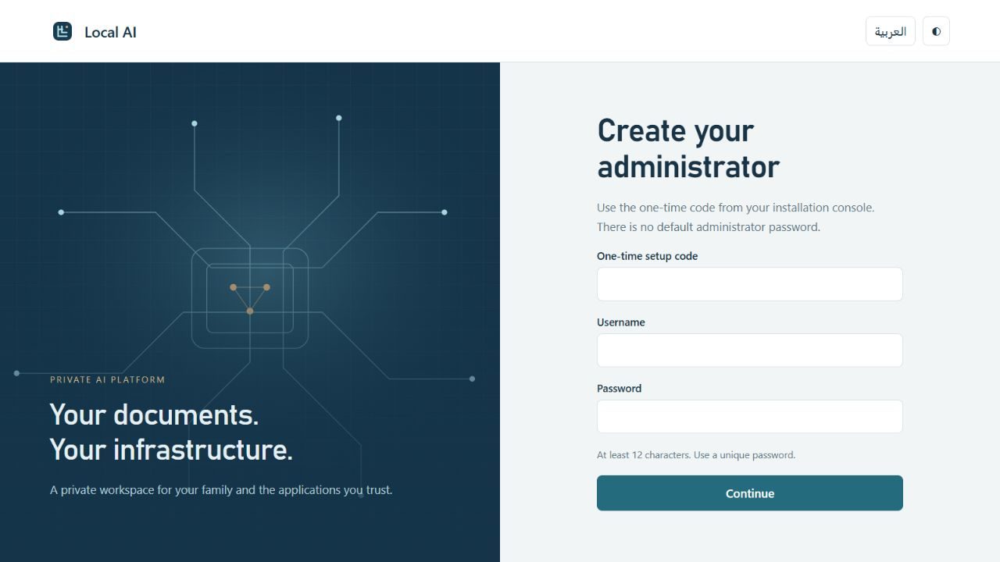
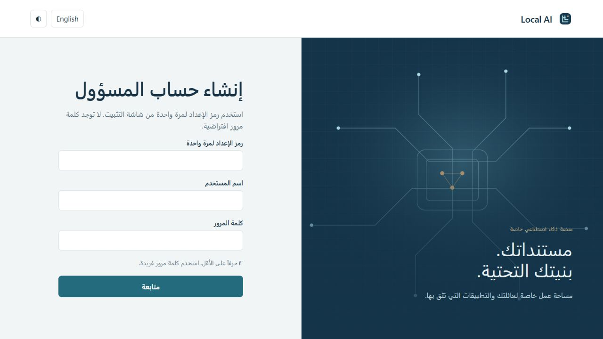

# Phase 2 browser security preview verification

Source tested and deployed: 5e94921, following browser milestone 9c68519. Feature branch feat/phase-2-security, draft PR #3; no main merge or Stable release.

## Automated checks
- Windows Node 24.19.0: 45 tests, 43 pass, two explicit POSIX-only skips.
- Actual Debian 13 LXC: 45 tests pass, zero skips or failures; documentation registry/link checks pass.
- Native installer completed for both browser milestone and symlink fix, retaining the configured state and endpoint. Its PID-bound liveness probe passed with proxy mode enabled.
- HTTP tests exercise real requests, SQLite state, MFA setup, secure cookies, session revocation, exact Origin/CSRF, bounded JSON, duplicate cookies, spoofed Host and untrusted proxy peers. Signed WebAuthn assertions cover credential verification, replay, wrong origin and browser challenge binding.
- No generated evidence here grants production release. The full release gate remains blocked.

## Deployment observations
The user confirmed Nginx Proxy Manager at 192.168.10.245. Only a new localai.ansariz.biz proxy host was configured, forwarding private HTTP to 192.168.10.214:1234, using the existing wildcard certificate, Force SSL and HTTP/2. Other hosts were not changed.

External HTTPS setup returned 200 with certificate validation enabled. HTTP returned 301 to the exact HTTPS origin. Direct LAN HTTP access to browser routes returned 403. Readiness returned 503 with setup_required, runtime_not_provisioned and release_not_qualified before administrator setup. The expanded root filesystem reports 99 GB total, 93 GB available.

Real browser checks confirmed the initial setup page renders in English and Arabic with mirrored RTL layout. Screenshots contain no credentials:

An independent read-only review found no critical transport/CSRF bypass. Its important finding—non-discoverable credentials could register despite username-free login—was reproduced with a failing options assertion, fixed by requiring discoverable credentials and verified green. The one-time application key is now displayed before a fallible list refresh. Optional application expiry controls/status in the UI remain a documented minor gap.

Actual deployment exposed a CLI entrypoint defect when invoked through the current symlink. Both setup-code and lifecycle tools now resolve their invoked path before deciding whether to execute. The Linux regression test verifies invalid calls through symlinks fail, rather than silently succeeding. The installed setup-code tool then successfully issued a private 30-minute code; it is not included in this repository.

## Gates still blocked
- Administrator password and authenticator enrollment require the user's credential handoff. No agent-selected administrator password was installed.
- Real browser authenticated navigation, application management, recovery and physical passkey journeys still require completion.
- Direct TLS installer probing, full user/group management and operational account/vault recovery are not qualified.
- Native schema-update failure/restore qualification for the security migration remains pending; the earlier foundation rollback evidence alone does not prove it.
- AI inference, Qdrant, document ingestion/OCR and later platform phases remain unimplemented. Do not interpret this preview as a complete or production-ready platform.
