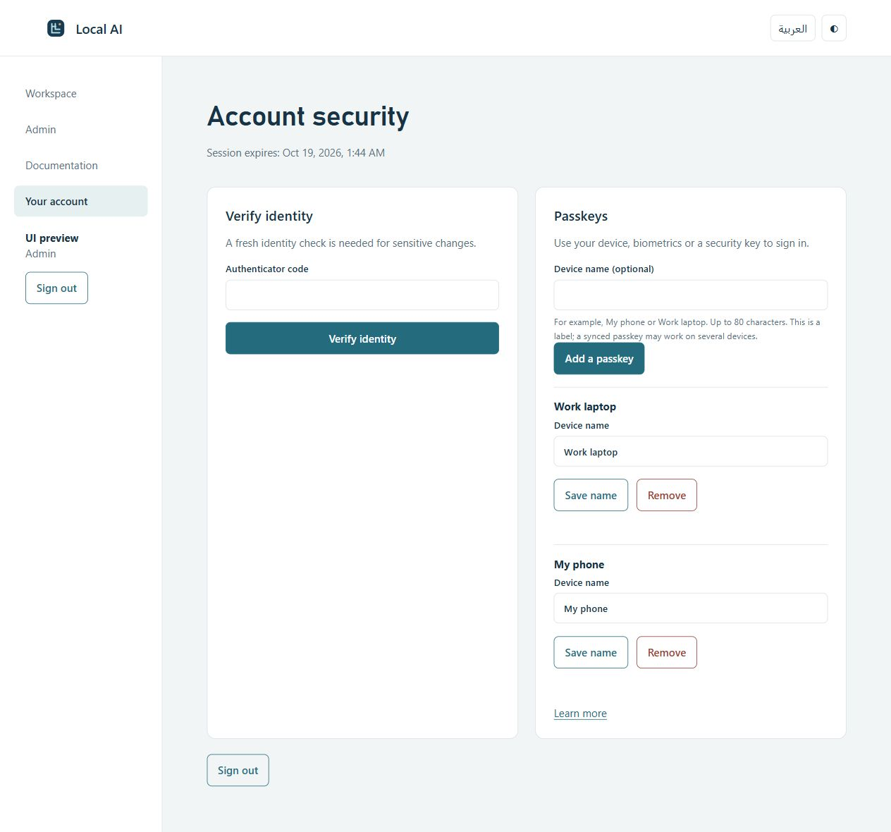
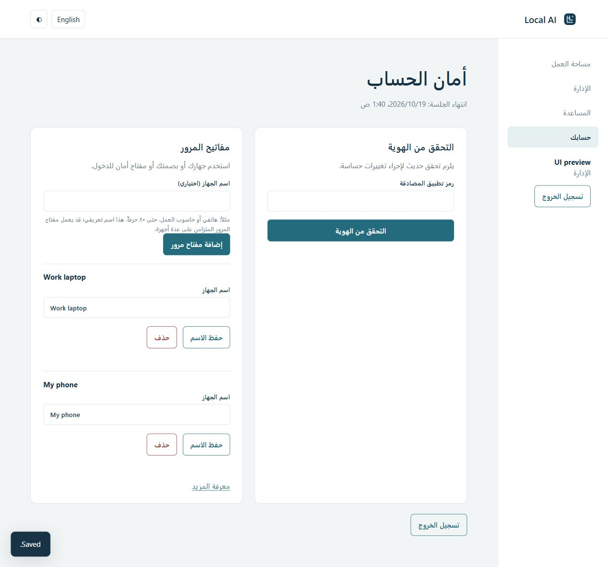

# Passkey device-name verification

Source tested and deployed: a50ed86 on feat/phase-2-security, draft PR #3.

The user confirmed real passkey enrollment and sign-in succeeded, then requested readable device names. The account page now offers an optional name before enrollment and Save name for existing credentials. Raw credential IDs are no longer displayed as the device title. Unnamed existing credentials remain valid and show a localized fallback until named.

## Validation
- Actual Debian 13 LXC: 51/51 tests passed, zero skips or failures; documentation checks passed.
- Windows: 49 passed, two explicit POSIX skips, zero failures. Both required GitHub CI jobs passed at a50ed86.
- A real signed registration test observed missing-name persistence fail before implementation, then passed with name persistence, Arabic rename, repository reopening, CSRF/fresh-session checks and owner-only changes.
- Real HTTP tests cover naming an existing synthetic credential, invalid length, missing CSRF, wrong credential ownership, name retrieval and credential removal. Names do not appear in audit event data.
- Names are validated and rendered as text. The shared browser/server module normalizes Unicode and enforces 80 code points, preventing divergent UTF-16 browser limits. Browser visual checks saved 80 supplementary characters and rejected 81.
- Independent read-only review reported no Critical/Important findings and the Minor length mismatch above; that mismatch was fixed. Complete-platform acceptance was outside this focused review.
- The native installer accepted this unchanged-schema update. Its compatibility gate and PID-bound liveness checks passed; the service remains active and account setup remains initialized. Public HTTPS serves the updated UI and its shared validator.

## Screenshots and limits
These visual checks use an isolated local preview with synthetic sample devices, not the user's account. Rename interaction and English/Arabic layouts were checked. Actual HTTP/session enforcement is covered separately by the real backend tests; the visual fixture does not certify production authentication. No agent enrolled, renamed or removed the user's passkey.

Labels are ordinary private preferences in the existing settings table, transactionally associated with credential ownership and deleted with the credential. No schema migration was added or installer gate bypassed. They describe the user's chosen label and do not prove a particular physical device, especially for synced passkeys.

Recovery browser acceptance, broader user/group administration, operational vault/account recovery and schema-transition recovery remain pending. Production release stays blocked.
