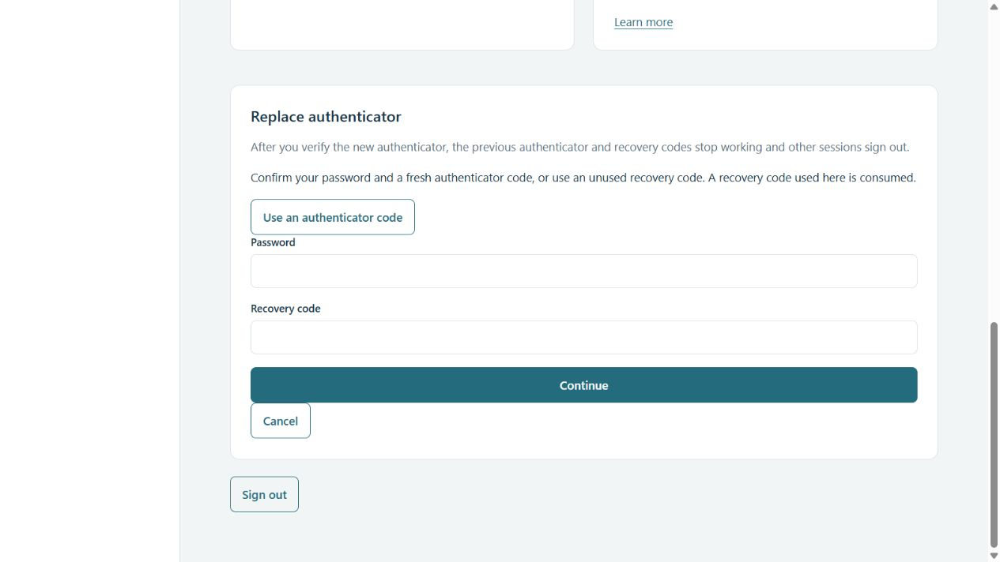
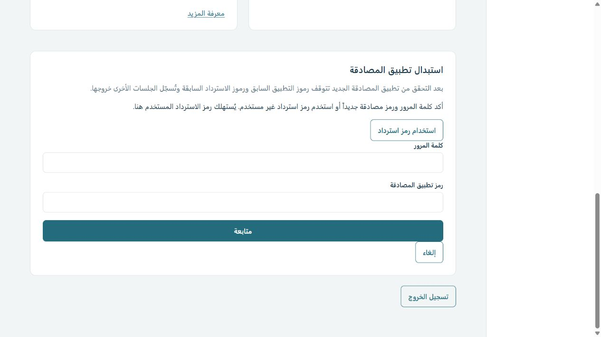

# Authenticator replacement and authorization verification

Source tested and deployed: cb88f09 on feat/phase-2-security, draft PR #3.

Actual Debian 13: 59/59 tests passed with no skips/failures. Windows: 57 pass, two explicit POSIX-only skips. Both required GitHub CI checks passed at this source revision. Documentation checks passed. Native unchanged-schema installation, compatibility gate and PID liveness checks passed; the service remains active, account setup remains initialized and HTTPS serves the replacement controls. No agent replaced or enrolled factors on the user's account.

The new recovery flow requires an active session/CSRF plus explicit password and current-factor/recovery proof, rotates the session at begin and uses an encrypted five-minute session-bound pending secret. New-factor verification and challenge consumption share the transaction that replaces TOTP/recovery codes/sessions. Tests cover old code/session revocation, replay, challenge/session/expiry binding, account-budget enforcement across source IPs, password-verification revocation races and rollback after an injected database failure. Real HTTP tests verify cookie rotation, token filtering and recovery login after replacement. A fixture role downgrade immediately denies administrator routes and application provisioning even for an existing session.

Read-only review found one Important continuity defect: premature challenge consumption made a typo or database failure unretryable, potentially stranding a user who used the final old recovery code. Both regression cases failed before the fix and pass after checking/consuming the challenge atomically with replacement. Failed-attempt counters remain persistent outside the rollback. There were no Critical findings.

English/Arabic visual checks use an isolated local preview with synthetic data and empty credential fields. Factor-choice controls and instructions were inspected; they are not screenshots of the user's account. Full browser submission was not performed against real credentials. Actual state changes are tested through real HTTP and SQLite fixtures.

## Phase gate ruling
The master's phase-2 foundational gate—concurrent setup, recovery abuse, proxy spoofing and authorization tests—passes for the implemented control plane. Password/TOTP and physical passkey sign-in were also confirmed by the user. This permits preparation and isolated implementation of the CPU runtime; it does not qualify the whole platform or v1.0.0.

Broader Workspace user/group/namespace policy belongs to phase 8, the full administrative control surface to phase 9, encrypted vault/backup-loss recovery to phase 12, and complete production upgrade/schema-restore qualification to phase 15. Those remain explicit mandatory release blockers. The current installer continues rejecting schema-changing updates until recovery is qualified. Full browser recovery submission and broader end-to-end UI acceptance remain production QA work, not inferred from these backend tests. Any new Critical/Important security failure blocks advancement until fixed.
